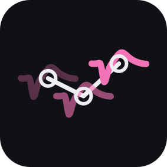

# multiphy — cross-day single-unit matching and curation

Matching units across days in a semi-chronic preparation, where the probe goes
in afresh each day and the brain moves. The stimulus-response fingerprint is a
central source of evidence; multichannel waveform and firing-pattern evidence
can be compared through the same interface. Performance on chronic implants or
within-session temporal splits does not by itself establish reinsertion accuracy.

## Comparing methods and curating unmatched units

The viewer runs no matcher. Runs arrive through the viewer's run list or
**Import**. Only explicit `SU` labels are eligible; unknown quality and
multi-unit labels are excluded. These labels come from spike-file comments and still require quality review.

Two local methods learn from every day of their project. `functional_likelihood`
scores firing, waveform and optional event-response likelihood ratios; its same/different
references are each unit's own halves (trials in event runs, else 5 s chunks) and same-day
neighbours within `radius_um`, pooled over the project, and a mixture fitted on every gated
candidate of a day pair gives the posterior. `pair_logistic` fits a logistic model on the
same labeled examples from alternate sessions (days, or a same-day run's two halves) and
calibrates it on the held-out sessions.
Its waveform properties compare each pair on the union of both units' channel neighbourhoods (channels within 150 µm of the peak whose largest voltage in the spike window is at least 10% of the peak channel's, plus the 5 nearest), the waveform correlation over the spike window only (`waveform_channels` `peak_threshold`, the default); `full_array` uses every channel and sample.
Both register each day's
depth from confident matches before the proximity gate. Both track with the
common tracker: deterministic best-first assignment with mutual candidate
margins, one unit per recording session, and rejection of merges containing
strongly contradictory measured pairs. It permits unmatched units and missing
sessions; it is not a globally optimal tracker. `functional_likelihood` scores
are uncalibrated posteriors, not validated identity probabilities.

Both declare `real_days=True` and take per-day trial timing (`TrialTiming`) as optional;
`launch run` passes it from the `source/` entry of each day with trial events. On days
without events, or days with no condition on every chosen day, either runs without
events: 5 s chunks stand in for trials, spont comes from the whole recording when a day
has no baseline windows, and no event-response stream is fitted. `launch run` prints each
fallback as a `warning · <reason>` line, and the run saves the reasons as `run_evidence`
in its provenance.

Split partitions the selected members from the remainder. Drop detaches a
member into an unmatched singleton. Merge combines selected groups, including
unmatched units. Tables and plots refresh together after edits. Each across-days
run has its own history, `curation/runs/<run>/history.csv`, so switching runs
does not touch another run's curation.

`backends.MatchResult` provides the common units, pair evidence, tracks,
unmatched units, and provenance contract. The `backends/` adapters call genuine
optional UnitMatch, DANT, and DeepUnitMatch implementations; missing packages,
raw waveforms, or checkpoints produce explicit errors rather than substitutions.
Published algorithm outputs must state whether native tracking or the common
local tracker formed their groups.

Use **Import matching result…** in a viewer to load the `result.json` of another
completed run of the same selection. Its native match scores remain
authoritative; the viewer adds the measured stimulus and physiology evidence
for inspection. Each imported method/run has
its own curation history. UnitMatch and DeepUnitMatch default to their official
intermediate tracking rule and 0.5 threshold; the local tracker's threshold is
separate. DANT cluster membership is displayed without inventing a probability.

Real recording days live in a **project** (see
[docs/project_folder.md](multiphy/docs/project_folder.md)): `launch init` adds each day once,
`launch extract` extracts its features once, and `launch run` runs any registered
backend on a selection of extracted days. `python -m multiphy.run
list-backends` names every registered backend and whether this interpreter can run
it; one that cannot runs in `--python EXE` or the verified interpreter.

```bash
# every extracted day of project M1, matched across days
python -m multiphy.launch run M1 --backend functional_likelihood
# chosen days, or one day's two temporal halves
python -m multiphy.launch run M1 --backend unitmatch --days D1 D2
python -m multiphy.launch run M1 --backend dant --day D1
```

`python -m multiphy.launch gui` runs the same commands from one window and
opens runs (see `docs/project_folder.md`).

Each run is a new folder, never replaced: across-days runs in the project's
`runs/`, same-day runs in `days/<day>/runs/`. The folder holds `selection.json`
(the project identity, the days, their feature ids and the excluded units) and
`pairs.csv` before the backend starts, and `result.json` when it ends. A failed
run keeps its folder with manifest status `failed`; running again makes a new
folder. Every refusal comes before the folder exists.

The viewer opens completed project runs and starts none; one command opens either kind
(see [docs/viewer.md](multiphy/docs/viewer.md)):

```bash
python -m multiphy.viewer --run /path/to/M1/runs/<run>            # across days
python -m multiphy.viewer --run /path/to/M1/days/D1/runs/<run>    # one day's halves
```

A run opens only when its `selection.json` still matches the project. The
viewer lists the completed runs of the same selection, and imports a result only
from one of them. In across_days mode the viewer curates its run in
`curation/runs/<run>/history.csv`: one line per curator action, undo and redo
included, the file replaced whole on each write. A merge may put two
observations from one calendar day into one track; the track row flags it.
`history.lock` lets one viewer write: a second viewer of the run opens
read-only, and a lock from another host can be taken over.
`launch export PROJECT --run RUN [--out PATH]` writes the accepted tracks to
`curation/runs/<run>/exports/accepted_tracks_<YYYYMMDD-HHMMSS>.csv`. Same-day
runs are inspect-only. Across-days runs have no temporal benchmark labels,
partitions or accuracy estimates; a same-day run is scored against its day's
source labels.

Benchmark archives and collections have no GUI view; their CLI scoring is
unchanged. Extraction, dependency installation and model training use explicit
commands; see [MATCHING_INTERFACE.md](multiphy/MATCHING_INTERFACE.md).

See [DEVELOPMENT.md](multiphy/DEVELOPMENT.md) for implementation priorities, the temporal
split benchmark contract, and the remaining data/training work.
See [BENCHMARKS.md](multiphy/BENCHMARKS.md) for extraction, comparison, and training
commands. Runner code stays in this package; generated benchmarks and checkpoints
stay under `<root>/benchmarks/`, and each project keeps its
own runs under `runs/` and `days/<day>/runs/` and its curation under `curation/runs/<run>/`.

New benchmark inputs use one shared filtered, median-referenced, unwhitened
waveform representation. Buffered filtering precedes snippet cropping. Only
waveform summaries persist; methods reuse the same archive and perform any
additional method-specific transformations in memory. This tests the methods
on shared inputs, rather than reproducing each author's extraction recipe.

## Plugins

A plugin module with `register(api)` adds source readers and launcher commands. The
launcher finds plugins in `<root>/multiphy.json` and the `multiphy.plugins` entry points.
The how-to is `multiphy/docs/adding_a_source.md`.

## Layers

| module | role | imports |
|---|---|---|
| `features.py` | spiking statistics: spike width, trial split halves, interval histogram and autocorrelogram | numpy/pandas |
| `contract/` | the backend contract: `MatchingInput`, `BackendSpec`, `MatchResult`, `Provenance`, the registry, and every display name | numpy/pandas only |
| `backends/` | single-unit results: the local `functional_likelihood` and `pair_logistic` matchers plus the UnitMatch/DANT/DeepUnitMatch adapters, registered on import | numpy/pandas; upstream packages imported lazily, only when run |
| `run/` | one runner loop, the option schema shared by the CLI and subprocess launcher, the run directory and result file format | numpy/pandas |
| `evaluation.py` | held-out source-cluster evaluation and partition checks | numpy/pandas |
| `store.py` | pair canonical ids, chains, consistency | numpy/pandas only |
| `curation.py` | one writer per run: history, undo/redo, lock, export | numpy/pandas only |
| `viewer/` | the PySide6 viewer: one `App`, the `across_days` and `same_day` modes, registered panels; see `docs/viewer.md` | the above, plus Qt (`data.py`, `display.py` and `modes/` import none) |
| `project/selection.py` | a `Selection` of one or more extracted project days: its dataset, trial timing, conditions and `selection.json` | numpy/pandas |
| `run/project_run.py` | runs one registered backend on a selection into its `runs/` folder, and lists a selection's runs | lazy backend imports |
| `launch/` | the launcher: `__main__.py` (the CLI), `commands.py`, `plugins.py`, `forms.py` (forms read from the CLI parser) and `window.py` (the launcher window, `launch gui`) | Qt only in `window.py` |

The contract is documented in `docs/contract.md`; adding a method is `docs/adding_a_backend.md`.

`backends/local/evidence.py` and `store.py` import no UI toolkit and no recording loader, so
the science is testable without a display and the viewer is replaceable.

## Use

```bash
# curate a completed project run
python -m multiphy.viewer --run DIR
```

Keyboard (defaults; `Help` ▸ `Keyboard shortcuts` changes them): `W` / `S` up / down in the active day, `A` / `D` previous / next day, `F` string the picked unit's track, `Esc` clear the string, `X` drop the active day's unit; `E` accept, `R` reject, `U` unsure (a pair verdict, then a step down); `Q` merge, `Shift+E` / `Shift+R` accept / reject the picked unit's track, `Shift+X` unmatch the active unit; `Ctrl+Z` / `Ctrl+Shift+Z` undo / redo.

An across-days run's curation is `<project>/curation/runs/<run>/history.csv`,
one line per curator action, undo and redo included; the file is replaced whole
on each write. Export the accepted tracks with:

```bash
python -m multiphy.launch export PROJECT --run RUN [--out PATH]
```

## Choosing the sounds

The fingerprint, the rates and the spiking statistics come from the same recording, since
the physiology references are calibrated on within-session split halves.
Which recordings make a day is the source plugin's choice.

## The criteria

The historical thresholds in `evidence.Criteria` were selected using
within-session split halves. The proximity threshold limits candidate
generation. Rate, interval, and width gates are displayed diagnostics; the
automatic backend does not require every diagnostic gate to pass.

| criterion | threshold | rejects of gated neighbours |
|---|---|---|
| proximity | 40 μm after rigid depth alignment | — |
| spontaneous rate, abs diff of log | 0.293 | 84% |
| inter-spike-interval histogram, cosine | 0.978 | 88% |
| spike width, abs diff | 0.15 ms | displayed diagnostic |

Score, applied to whatever survives: three streams of evidence (the event response
only in runs with events), each property contributing a likelihood ratio built from its own same-neuron and
different-neuron references, so a value that merely misses a threshold is
penalised rather than discarded and missing evidence is neutral.

| stream | properties |
|---|---|
| event response | fingerprint correlation |
| physiology | spontaneous rate, interval histogram, autocorrelogram + session rate (events only) |
| waveform | waveform correlation, footprint correlation, spike width (peak channels) |

The streams are combined by weights fitted on the reference pairs where they
exist, not asserted. The event response comes out heavier wherever it has been fitted.
Rate, interval histogram and autocorrelogram are not independent — rate sets the interval
scale and the autocorrelogram restates the short intervals — so summing their ratios would
be overconfident; fitting the weights and then calibrating the combined score
against the same references absorbs that.

All the probabilities are on screen: the combined one is the headline, the
three streams (the event response only in runs with events) sit beside it, and the
mixture panel shows the reference and observed distributions behind each.
A pair the event response convinces on but the
physiology does not is visible as such rather than averaged away.

The project-wide references do not guarantee conservative or accurate cross-day
probabilities. They come from every day of the project: each unit against its
own other half (trials in event runs, else 5 s chunks), and same-day neighbours within
`radius_um`. Each day pair's
mixture is fitted on every gated candidate, not on best candidates, and
candidates are scored half against half, so references and candidates share one
sampling noise. Same-day neighbours are not a guaranteed stand-in for different
units across days.

## The views

| view | what it answers |
|---|---|
| Waveform | do the peak-channel spikes look alike |
| Footprint | where on the shank the unit sits, all days on one registered axis |
| Probe map | which electrodes each unit appears on |
| Waveforms on the probe | how each unit's spike varies across the electrodes it is on |
| Interval histogram | do the inter-spike interval distributions look alike |
| Autocorrelogram | do the two-sided autocorrelograms look alike |
| Fingerprint | the event response, all shared conditions or one at full width |
| Tuning | tone curve, shown only, never scored |
| Mixture | how each stream's probability and the combined one are formed |

The probe map splits each electrode into one vertical strip per selected unit,
and a unit always owns the same strip, so reading down the probe follows one
colour in one column. Amplitude is deliberately absent: with units of different
amplitude on one electrode, an amplitude-scaled mark hides the weaker one, and
the question this view answers is which units touch which electrodes. Amplitude
is on the footprint, and shape is on the waveform view, which draws each unit's
template at the coordinate of every electrode it was recorded on, after phy.

## How two days get linked to the same sounds

**The join, on the recordings.** A condition is the `condition` label of an event in the day's events file. `condition` labels are stripped of surrounding spaces, then compared exactly, across trials and across days. A label must name everything that makes the condition, for example the sound and the ear.
In a run with events, `functional_likelihood` scores a group of days on the conditions that every
kept unit measures with at least `min_repeats` repeats, in its reference
fingerprint and in both halves of every split, and each fingerprint is those
conditions' histograms concatenated in sorted order. A group with no such
condition is skipped with the reason recorded.

## Tracked units

Common tracks come from the common tracker (`backends/local/tracker.py`: mutual
margins, one unit per session, measured contradictions): `functional_likelihood`
and `pair_logistic` always, `unitmatch` and `deepunitmatch` only when
`tracking='common_constrained'` is chosen. Native tracks (`dant`, and
`unitmatch`/`deepunitmatch` in their default native modes) keep their backend's
own rules and are not checked for margins or contradictions.
When a native group holds two or more observations from one session, the adapter keeps the one with the highest mean native score to the group's observations from other sessions (missing scores are skipped; a tie goes to more spikes, then the smaller cell ID); the others stay unmatched, and every pair inside the group that is not two members of one track is saved with decision proposed_link.

A neuron belongs to at most one tracked unit. The matcher proposes the tracks:
a run's `result.json` holds them and its unmatched units. A curator accepts,
rejects, splits, merges and edits them in that run's own history; see
[docs/project_folder.md](multiphy/docs/project_folder.md), section 2, for
`curation/runs/<run>/history.csv`, `history.lock` and `launch export`.

## Reading the output

`store.chains()` turns accepted edges into connected components, a neuron
followed across days. Matches are stored as edges rather than chains on purpose:
if day 1 to day 2 and day 2 to day 3 are accepted but day 1 to day 3 is
rejected, `store.inconsistencies()` reports that triangle instead of resolving
it silently.


## Caveats that matter when using the matches

Matching on event responses selects for similar event responses. The matched set
therefore cannot be used to argue that tuning is stable across days; that
question needs a different identity criterion, or the selection has to be
modelled. Selection can also affect other outcomes correlated with the matching
features. Holding out trials reduces measurement-noise reuse but does not
eliminate this biological selection bias.

Depth alignment comes from unit-density profiles and has a noise floor near
20 μm, measured by running it on same-day recordings where the true offset is
zero. That is why the proximity gate is 40 μm rather than tighter.

Each day's electrode coordinates come from its own recording. A day without
measured geometry draws `no measured geometry` in the probe, waveform-map and
footprint views. A unit whose channel count differs from its day's geometry
refuses the run, naming the unit, the day and both counts.

Single units and multi-unit clusters are both included. A multi-unit cluster's
fingerprint is a blend, so its match means something weaker.
