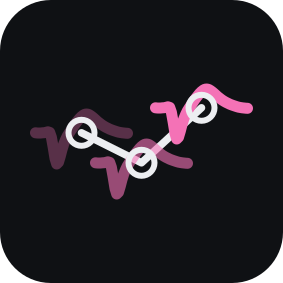

# multiphy — cross-day single-unit matching and curation

multiphy is an app to help track the same neurons across days in in vivo
electrophysiology recordings. It supports multiple matching algorithms out of
the box, with a unified graphical interface for visualizing, comparing and
curating their results.


## Video walkthrough

[Watch the 6½-minute UI tutorial on YouTube](https://youtu.be/b9Ok8NqrHss).
Follow a microwire project from recording import through extraction, matching and
accepted-track export, including keyboard shortcuts, drift-map selection and
plot layouts. Includes AI narration and on-screen captions.

## Install

Choose the Windows desktop application or a Python/uv environment. Both use the
same project folders and curation files.

### Windows desktop application

Download the [v0.0.0 Windows desktop preview](https://github.com/jwingert/multiphy/releases/tag/v0.0.0):

- **[Installer](https://github.com/jwingert/multiphy/releases/download/v0.0.0/multiphy-0.0.0-windows-x64-setup.exe)**: install, then open the **multiphy** shortcut.
- **[Portable ZIP](https://github.com/jwingert/multiphy/releases/download/v0.0.0/multiphy-0.0.0-windows-x64-portable.zip)**: extract the whole folder and open `multiphy-gui.exe`.

No separate Python installation is needed. The bundle includes the two built-in
matchers, `functional_likelihood` and `pair_logistic`. This preview is unsigned,
so Windows may show a publisher warning. See the [desktop guide](multiphy/docs/desktop.md)
for first launch, download checksums and updates.

### Python / uv installation

Use this option for Linux, development, notebooks, plugins or optional backends.
Install [uv 0.13.4](https://docs.astral.sh/uv/getting-started/installation/), then
run these commands in PowerShell, Git Bash or a Linux shell:

```sh
git clone https://github.com/jwingert/multiphy.git
cd multiphy
uv python install
uv sync --locked --extra gui
uv run --no-sync python -m multiphy.launch --root "../multiphy-data" gui
```

This uses the repository's pinned Python 3.12 environment and stores projects in
`multiphy-data` beside the code folder. You can replace that path with another
data folder. The [Python setup guide](multiphy/docs/installation.md) covers Linux
system libraries, Windows interpreter setup, testing and optional backends.

UnitMatch, DANT and DeepUnitMatch need separate dependencies or model checkpoints;
see [optional backend setup](multiphy/docs/installation.md#optional-backends).

## Basic workflow

1. **Create a project and add recordings.** Supply each recording's name, date and
   phy folder. Matching also requires raw voltage and its µV/bit scaling; events
   are optional.
2. **Extract features.** Prepare each recording once for reuse across matching runs.
3. **Run a matching algorithm.** Select the recordings and backend in the launcher.
4. **Compare and curate.** Open a completed run, inspect units across days, and
   review its proposed tracks. Ctrl-click units to compare them, press `Q` to
   match their tracks, then `E` to accept the picked track. `X` unmatches a unit;
   `R` rejects a track. Selection alone does not change matches.
5. **Export accepted tracks.** Each run keeps its own curation history, including
   undo and redo; only accepted current tracks appear in the export.

## Documentation

| Guide | What it covers |
| --- | --- |
| [Projects and launcher](multiphy/docs/project_folder.md) | Recording inputs, voltage scaling, extraction, project checks, CLI commands and export |
| [Viewer and curation](multiphy/docs/viewer.md) | Hotkeys, backend and reviewer states, plots, drift map and layouts |
| [Matching methods and settings](multiphy/MATCHING_INTERFACE.md) | Algorithm inputs, grouping rules, checkpoints and run options |
| [Matching evidence and interpretation](multiphy/docs/matching.md) | Local scoring, waveform and event evidence, diagnostics and limitations |
| [Benchmarks and training](multiphy/BENCHMARKS.md) | Temporal comparisons, evaluation and model training |
| [Architecture and extensions](multiphy/docs/architecture.md) | Package layout, backend contract, and adding a matcher or source reader |
| [Development notes](multiphy/DEVELOPMENT.md) | Implementation history, priorities and validation work |

Released under the [MIT License](LICENSE).
